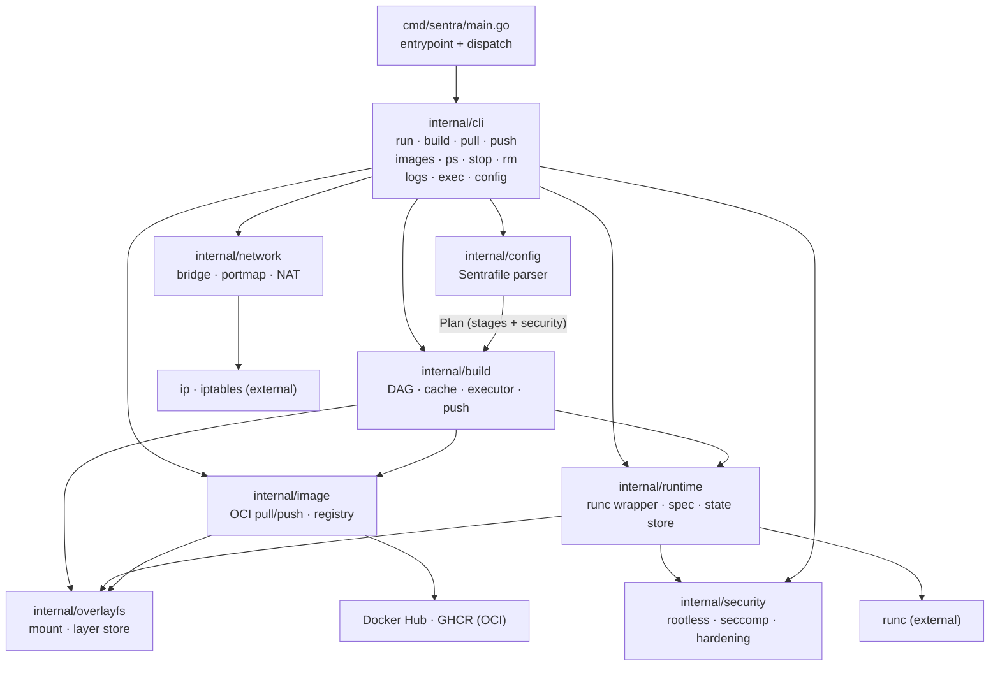

# Architecture

Sentra is a single Go binary (`CGO_ENABLED=0`) with no daemon. The CLI forks
directly into Linux namespaces, wraps `runc` for container creation, and stores
all state as plain files. No background service, no socket, no lock server.

## Component diagram



## Package-by-package

### `cmd/sentra`

Thin entrypoint. Parses the subcommand and dispatches to the matching
`internal/cli` function. No logic lives here.

### `internal/cli`

Command implementations. Each command is a single `Cmd(args []string) error`
function that:

1. Parses flags with the stdlib `flag` package.
2. Calls into the relevant `internal/*` package.
3. Formats and prints the result.

The `run` command is the most complex: it resolves the rootfs (from `--rootfs`
or `-t TAG`), merges the image's recorded env/expose/entrypoint with explicit
flags, sets up networking, builds an OCI spec via `runtime.BuildSpec`, creates
a runc bundle, and invokes `runc run` (foreground) or `runc create` + `runc
start` (detached).

### `internal/config`

The `Sentrafile` parser. Turns raw bytes into a `Plan` (one or more `Stage`s
plus a `Security` posture). Each stage is a `base` image plus an ordered list
of `Step`s. The parser validates syntax, stage references, and the
`cache`/`secure` invariants. Nothing downstream re-reads the raw text.

### `internal/build`

The build engine. The execution model is **overlayfs-native**:

1. The base image's extracted layer directories become the overlay lowerdirs.
2. Each mutating step (`copy`, `exec`) gets a fresh upperdir mounted over the
   accumulated chain.
3. Whatever the step writes lands in that upperdir — exactly the diff worth
   caching. No tar/untar round-trip.

Key pieces:

- **`dag.go`** — turns a stage's steps into a dependency graph. Independent
  steps run concurrently (bounded by `--workers`).
- **`cache.go`** — content-addressed layer cache. A step's key is
  `sha256(step type, canonical args, parent layer id, input file hashes)`.
  `copy` steps are auto-cached; `exec` steps only via an explicit
  `cache key=` override.
- **`executor.go`** — drives the build stage by stage, mounts per-step
  overlays, runs `exec` steps through `runc`, and assembles the final merged
  rootfs.
- **`push.go`** — packs build layers into gzipped OCI tarballs for registry
  upload.

### `internal/runtime`

The container runtime layer:

- **`container.go`** — `Container` record (persisted as JSON), `BuildSpec`
  (produces the OCI `config.json`), the state store (`SaveContainer`,
  `LoadContainer`, `ListContainers`, `RemoveContainer`), and state-dir
  resolution (`/var/lib/sentra` root, `~/.sentra` rootless).
- **`runc.go`** — wraps the `runc` binary: `Run`, `Detach`, `Exec`, `Kill`,
  `State`, `Delete`.
- **`namespace.go`** / **`cgroups.go`** — declare the Linux namespaces and
  cgroups v2 resources that go into the OCI spec.

### `internal/image`

OCI image operations, backed by `go-containerregistry`:

- **`pull.go`** — resolves a reference, fetches the manifest and layers
  (content-addressed, digest-verified), extracts layers to `layers/<digest>/`,
  and merges them into `rootfs/<name>/`.
- **`push.go`** — assembles the base image plus build layers into an OCI
  image and writes it to a registry. Auth via `SENTRA_REGISTRY_TOKEN`.
- **`registry.go`** — registry client setup.

### `internal/overlayfs`

Storage layer:

- **`layer_store.go`** — `LayerDir`, `HasLayer`, `Merge` (stack lowerdirs into
  a merged rootfs).
- **`mount.go`** — `MountStep` (mount a lower chain + fresh upperdir for a
  build step), `Probe` (test whether overlayfs works here), `CopyTree`
  (fallback when overlayfs is unavailable).

If overlayfs is unavailable (e.g. non-root without a usable user namespace),
builds degrade to a single writable rootfs copy with no layer caching.

### `internal/security`

Security posture enforcement:

- **`security.go`** — `Posture` (rootless, readonly, seccomp), `Apply` writes
  the posture into an OCI spec: rootfs readonly flag, masked/readonly paths
  (rootful only), and the seccomp profile.
- **`seccomp.go`** — emits the OCI seccomp profile JSON (no libseccomp — pure
  Go). Three levels: `unconfined`, `default` (broad allowlist), `strict`
  (default minus kernel/module/device syscalls).
- **`rootless.go`** — user-namespace ID mappings from `/etc/subuid` and
  `/etc/subgid`.

### `internal/network`

One bridge, one subnet:

- **`bridge.go`** — `sentra0` bridge on `10.89.0.0/24`, address allocation
  (claimed by writing to `network/allocations.json`), bridge creation, IP
  forwarding, masquerade.
- **`network.go`** — `Setup`/`Teardown`: create a netns, a veth pair, attach
  the host end to the bridge, assign an address, set the default route, and
  add DNAT rules for published ports. Invokes `ip` and `iptables`.
- **`portmap.go`** — parses `-p` syntax (`8080`, `8080:80`, `8080:80/udp`)
  and builds the four iptables rules per published port (PREROUTING DNAT,
  OUTPUT DNAT for localhost, hairpin MASQUERADE, FORWARD ACCEPT).

## Data flow: `sentra build`

```
Sentrafile ──config.Parse──▶ Plan (stages + security)
                                   │
                                   ▼
                          build.Build (executor)
                                   │
            ┌──────────────────────┼──────────────────────┐
            ▼                      ▼                      ▼
      image.Pull             overlayfs.MountStep    cache.Lookup
   (base image layers)    (per-step upperdir)       (content key)
                                   │
                                   ▼
                          runc run (exec steps)
                                   │
                                   ▼
                       overlayfs.Merge (final rootfs)
                                   │
                                   ▼
                     built/<tag>.json + built/<tag>-rootfs
```

## Data flow: `sentra run`

```
--rootfs or -t TAG ──▶ resolve rootfs + entrypoint + env + expose
                                   │
                                   ▼
                     security posture (defaults + secure directive + flags)
                                   │
                                   ▼
                          network.Setup (rootful)
                     (sentra0 bridge, veth, NAT, DNAT)
                                   │
                                   ▼
                         runtime.BuildSpec (OCI config.json)
                                   │
                                   ▼
                           runc run / runc create+start
```
